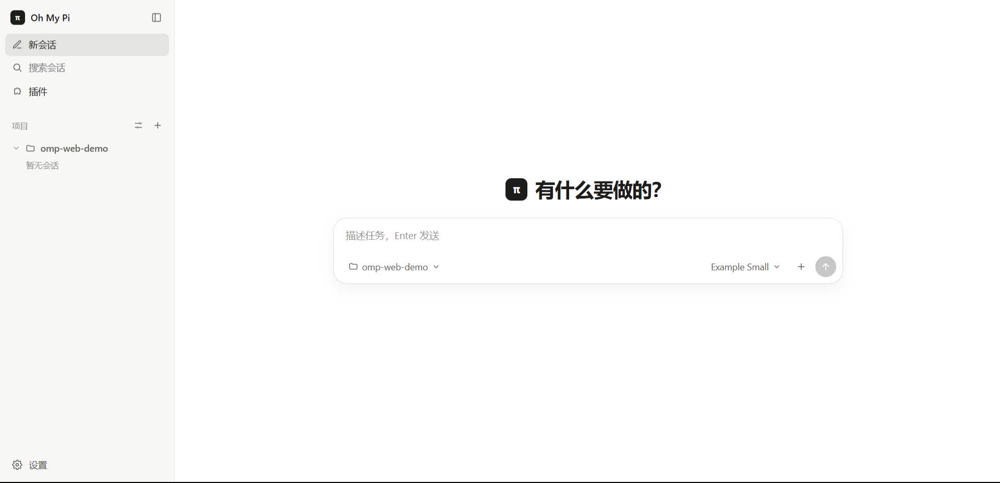
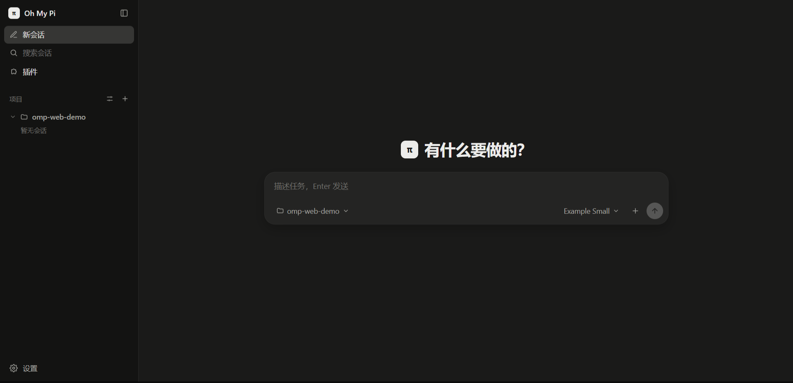
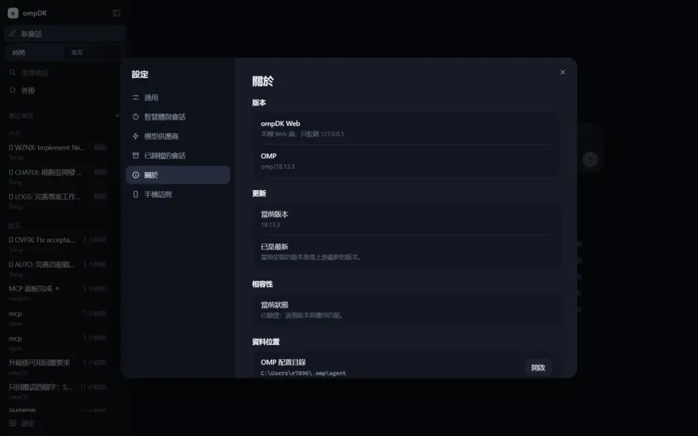

# Oh My Pi Web

简体中文：[README.zh-CN.md](README.zh-CN.md)

A local web UI for [Oh My Pi (omp)](https://github.com/can1357/oh-my-pi). Listens on `127.0.0.1` only.

A Bun gateway spawns one `omp --mode rpc-ui` child process per opened session and streams protocol frames over a WebSocket; a Vite + React client renders the conversation. Everything that knows about omp lives in `server/omp/` and `shared/omp/` — the rest of the code talks to those. No component library: hand-written CSS with light and dark themes.

The interface is Chinese-only so far; where this file names a control, it quotes the label it shows and adds an English gloss.

## Screenshots

Home — project and model pickers; the omp process starts on the first message. Light and dark:





Settings, 通用 (General) tab — theme, font size, fonts, column width, notifications and Enter behavior:



## Getting started

```sh
bun install
bun run build
bun run scripts/serve.ts            # http://127.0.0.1:30190 — your real ~/.omp/agent
bun run scripts/serve.ts --test     # http://127.0.0.1:30191 — isolated test profile
```

`--test` uses `.data/omp-agent` as the omp config directory and seeds it with an example provider and model (`scripts/setup-test-profile.ts`, which leaves an existing `models.yml` alone) — edit that file, or Settings → 模型供应商 (Providers), and point it at your own endpoint. The API key may be given as an environment-variable name.

For convenience, put a shim named `ompweb` somewhere on `PATH` that runs `bun run scripts/launch.ts`. It starts the gateway if none is running (building the frontend first when `web/` sources are newer) and opens the page; when one is already running it just opens the page — unless that gateway is older than `server/`, in which case it says so and waits for `--restart`. `--test` and `--no-open` are also supported.

- Changing `web/` only needs `bun run build` plus a page reload. Changing `server/` or `shared/` needs a restart.
- `--restart` is graceful: it asks the running gateway to shut itself down, and that gateway first drains its own omp children (up to 5 s) so no child is left holding a session file. Only if the port is still busy after 10 s does it kill the process tree. Hard-killing a gateway is what makes omp save a conversation away as a copy next time it opens that file.
- One omp config directory serves only one gateway: `web-gateway.lock` in the profile is claimed exclusively and carries `{pid, port, startedAt}`. `ompweb` that finds another gateway on the same profile opens its address instead; a second gateway started directly refuses to boot. On boot the gateway also terminates leftover omp children whose parent is gone and whose `--resume` file belongs to this profile, and logs how many it cleaned up.

## Development

Run the gateway and Vite in two terminals:

```sh
bun run scripts/serve.ts   # gateway: http://127.0.0.1:30190
```

```sh
bun run dev               # frontend: http://127.0.0.1:5190
```

Vite proxies `/api` and `/ws` to the gateway. To use the isolated `--test` gateway on port 30191, set `OMP_WEB_PORT=30191` in the Vite terminal before running `bun run dev` (`$env:OMP_WEB_PORT = "30191"` in PowerShell). Vite reloads frontend changes; restart the gateway after changes to `server/` or `shared/`.

## On your phone

Start the gateway with one extra flag, with the phone and the computer on the same Wi-Fi:

```sh
bun run scripts/serve.ts --lan      # or the ompweb entry point with --lan
```

The terminal prints the phone URL and this run's pairing code; **Settings → Phone access** shows the same thing plus a QR code, which logs the phone in without typing the code. That settings page only appears on the machine running the gateway. The phone gets the same frontend: below 760px the sidebar becomes a drawer, the right panel covers the screen, actions that normally need hover stay visible and larger, and Enter inserts a newline instead of sending.

- The code is six digits and changes every start. Pairing once keeps that phone signed in for 30 days; five wrong attempts lock the address for ten minutes, twenty lock every device out and rotate the code, and all phones can be signed out from the settings page.
- Drop `--lan` to go back to listening on `127.0.0.1` only.
- System notifications do not work over `http://` (the API requires a secure context); the settings page says so and disables the switch.
- Addresses from virtual adapters (`Meta`, `vEthernet`, …) are unreachable from a phone — use the Wi-Fi one.

**Only enable this on a home or trusted Wi-Fi.** It is plain HTTP: anyone on the same network can capture the pairing cookie and the conversation.

If the phone says it cannot reach the page, work through these in order:

| Step | What to do | What it tells you |
| --- | --- | --- |
| 1. Proxy client | Quit the desktop proxy client entirely (Clash Verge / mihomo — fully quit, not just TUN off), then retry from the phone | If it works, check that client's routes, TUN and filter rules |
| 2. Subnet | Read the phone's Wi-Fi IP address | It has to be on the same subnet as the computer; a different one means the two are not on the same network |
| 3. Phone-side VPN | Turn off any VPN/proxy app on the phone, or allow the local network | If it works, the phone's tunnel was carrying the private address too |
| 4. Another network | Turn on the phone's hotspot, connect the computer to it, and open the address the settings page now lists | If it works, check the original Wi-Fi for client isolation, routing and firewall policy |

## Features

Compaction now keeps earlier chat history visible. CLI subagent transcripts can be restored or viewed without opening another writer; Markdown renders while streaming, both sidebars support dragging their edges to resize, and `--lan` puts the same UI on a phone behind a per-start pairing code. See [the usage guide (Chinese)](docs/session-display.md). Restart the gateway and refresh the page after this update (API version 6).

| Area | What you get |
| --- | --- |
| Sidebar | Sessions grouped by project, searchable; per-session menu with rename, HTML export and archive; a grey 副本 (copy) tag on a session omp saved away because its original file was held by another process — never auto-hidden or auto-deleted, it is yours to archive; entry to the Plugins page; settings at the bottom, and a "connection lost" hint only while disconnected |
| Home | Project picker; the model chip picks the model for **this** new session and defaults to your configured default (not remembered per session); the session process starts only when the first message is sent; `/` opens the command menu here too, from a per-project cached command list, so it works with no session |
| Chat | Streaming replies with formulas typeset offline by KaTeX (`\[ … \]`, `\( … \)`, `$$…$$`, `$…$`; an unrecognized macro degrades only that expression, while prices and code stay prose), collapsible thinking whose body renders as markdown with one summary per line, compact tool rows that show a failure's first line under the row and fold consecutive same-name calls of one message into a single counted row ("Read ×15") that expands to each call, skill invocations folded into one "loaded skill X" row that opens its `SKILL.md` in the right panel, a finished turn collapsed to "processed · time" with counts covering every call inside folded groups and durations down to a tenth of a second, file-change cards with diffs, fork from any turn, copy your own message or edit it in place and resend (everything after it is dropped), slash commands rendered as their own right-aligned label plus output (one line inline, longer output as a card, collapse for very long), sent messages over twelve rendered lines initially show six; completed replies over twenty-four rendered lines can be collapsed to twelve; copy and editing preserve the full text, jump-to-bottom and fade |
| Composer | Slash-command menu grouped by purpose with recent-first ordering, one-line explanation of the highlighted entry, subcommands, argument hints, current values shown for toggles like `/fast`, commands that a UI control already covers redirect you to it, and destructive subcommands confirmed first; `@` file completion; image attachments (paste, drag, picker); stop; steer or queue while a turn runs, with queued messages retractable; model and thinking level |
| Interaction | Approval / select / input / editor / multi-question `ask` cards; reconnect card when the session process exits; recognized external OMP owners open as read-only history and subagent views, with a per-session read-only option for fresh CLI sessions; when omp saves a new file the UI follows its path and explains why in the transcript |
| Right panel | Info (todos, context usage, session), subagents (list, live progress and steps, steer, stop), files (tree + preview), changes (git status + diff); each preview has its own close button, leaving the list to fill the panel |
| Plugins | Skill cards ordered by origin (user / project / plugin-provided / auto-learned / other), disabled ones folded away, searchable, listed for the project you were in when you opened the page; a card opens its `SKILL.md`, lets you enable or disable it, copy its path, reveal it, or prefill `/skill:<name>` in a new session; the Plugins tab is a read-only list of installed plugins |
| Settings | 通用 (General: interface language, theme, font size, fonts, column width, notifications, Enter behavior, subagent sidebar), 智能体与会话 (Agent & session: default model and thinking level, default plan mode, subagent model, small model), 模型供应商 (Providers: add / edit / remove custom OpenAI-compatible endpoints, hide models you do not want to see, read-only view of installed models), 已归档的会话 (Archived sessions: restore, permanent delete), 手机访问 (Phone access — shown on the gateway machine only: LAN addresses, pairing code, QR code, rotate, sign every phone out), 关于 (About) |
| Phone | With `--lan`, a phone on the same Wi-Fi opens the app, types the pairing code once (or scans the QR code) and stays signed in for 30 days; below 760px the layout becomes a drawer sidebar, a full-screen right panel, always-visible touch targets, a composer the software keyboard does not cover, and an expanded process list whose header stays pinned while it scrolls |

Sessions get an automatic title after the first exchange (one extra model call, `OMP_WEB_AUTO_TITLE=0` to disable).

## Checks

```sh
bunx tsc --noEmit -p tsconfig.json   # types
bun test                             # unit tests (view-model logic + real recorded frames)
bun run build                        # production bundle
bun run lint:omp                     # no omp specifics outside server/omp/ and shared/omp/
```

## Layout

| Path | Purpose |
| --- | --- |
| `server/main.ts` | HTTP `/api/*` + WebSocket `/ws`: session index, rename, export, archive, delete, about, reveal |
| `server/orphans.ts` | Reads the OS process table: terminates only omp children whose parent is gone and whose session file belongs to this profile, and answers "is this session held by another live process?" |
| `server/profile-lock.ts` | One gateway per omp config directory: atomic `web-gateway.lock`, startup-window and health-based ownership, takeover and clean release |
| `server/omp-process.ts` | One `omp --mode rpc-ui` child: JSONL framing, v2 chunk reassembly, request/response correlation by id, capability handshake |
| `server/session-hub.ts` | One process per opened session: message mirror plus in-flight frame replay, dialogs, command list, command output records, subagents, rename, rekey onto a file omp saved away |
| `server/command-catalog.ts` | The slash-command list Home needs: caches the `available_commands_update` each session pushed, per project, stale-while-revalidate, falling back to a `--no-session` probe process; persisted to `<dataDir>/commands-cache.json` |
| `server/session-index.ts` | Head parsing of omp session files for the sidebar; recognises a file omp saved away from a held original by its `parentSession` + `providerPromptCacheKey` and points at the original |
| `server/archive.ts` | Web-only archive list (`<dataDir>/archived.json`; hides, never touches files) |
| `server/providers.ts` | Surgical `models.yml` editing for the settings page: block rewrite, backup first, other bytes untouched; omp reads the file back afterwards and a provider it cannot parse, a model it lost, or a schema error rolls the write back and reports omp's reason |
| `server/omp-config.ts` | omp config read/write through `omp config list/get/set --json`: 30 s cache, key allowlist with value validation, read-modify-write that only touches the named key |
| `server/agent-settings.ts` | Model roles (default / task / smol / slow / tiny), per-subagent overrides and the default plan mode; refuses writes on a locked test profile |
| `server/models.ts` | Model list with no session (`omp models --json`) and validity of role values |
| `server/plugins.ts` | Skills and plugins: per-project skill list, skills suppressed via `disabledExtensions` folded back in, `<dataDir>/skills-seen.json` metadata cache, `SKILL.md` reads |
| `server/files.ts` | File tree, previews, git status and diff for the right panel (confined to the project dir) |
| `server/projects.ts` | Project (working directory) list and folder browsing |
| `server/request-guard.ts` | Only accepts requests that arrive under a name this machine answers on (loopback, its own interface addresses, `OMP_WEB_ALLOWED_HOSTS`) and checks `Origin`: rejects cross-site pages and DNS rebinding |
| `server/lan-auth.ts` | LAN pairing: one six-digit code per start, per-address and global wrong-code limits, device tokens stored as digests only (`<dataDir>/lan-devices.json`), and the sorted list of addresses a phone can open |
| `server/omp/` | The only place that knows omp: `cli.ts` env vars and subcommand arguments, `errors.ts` error-text classification, `handshake.ts` + `capabilities.ts` per-item capability negotiation, `session-file.ts` session header fields, `compat.ts` tested version and boot self-check |
| `shared/commands.ts` | One table of slash commands: labels, grouping, icons, match ranking, argument hints, destructive detection, commands a UI control replaced |
| `shared/command-output.ts` | Message shapes for command output and "ran earlier" records, shared by gateway and browser; strips terminal escapes |
| `shared/omp/wire.ts` | Declares only the omp frame fields this project actually reads, plus the readers for them |
| `shared/omp/conventions.ts` | Constants scattered through the protocol: config keys, model roles, custom types, message roles, skill prefixes, title slot, directory layout |
| `shared/subagents.ts` | Subagent lifecycle/progress frame folding, shared by gateway and browser |
| `web/src/lib/session-store.ts` | Framework-free session state; streaming deltas merged per frame |
| `web/src/lib/app-store.ts` | Views and routing (home / session / plugins), session index, archive, settings window, notices, agent settings, skills and plugins |
| `web/src/lib/session-registry.ts` | Session identity, temporary-session activation, rekey, and attach/detach lifetime |
| `web/src/lib/preferences.ts` | Browser preference defaults, persistence, theme, fonts and column width |
| `web/src/lib/skills.ts` | Skill origin grouping, avatar colour, `SKILL.md` front-matter stripping, shared by list and drawer |
| `web/src/lib/ansi.tsx` | SGR colours in command output mapped to theme colours; 256-colour and direct colours snapped, plain text when unparseable |
| `web/src/lib/markdown.tsx` + `math.ts` | The pipeline that renders an answer: marked → KaTeX formulas (`math.ts` holds its tokenizer and renderer extensions) → DOMPurify; while a reply is streaming it shows escaped plain text and only typesets once the text settles |
| `web/src/lib/turns.ts` | Messages → turns / steps / command entries / tool labels / file changes / durations |
| `web/src/lib/i18n/` | Interface language: `index.ts` exposes `t(key, params?)` and `pick([zh, en])`, while `chat/chrome/panel/settings/shell.ts` each hold one area's message pairs. Chinese is the default; the setting also offers “follow the system” and English |
| `web/src/lib/viewport.ts` | The single narrow-screen breakpoint (760px) and the touch test; on iOS it publishes `visualViewport` height as `--app-h` so the software keyboard cannot cover the composer |
| `web/src/lib/clipboard.ts` | Copying text: `navigator.clipboard` in a secure context, `execCommand` fallback on an HTTP page (the only route a phone has) |
| `web/src/lib/qr.ts` | Encodes the pairing link as a QR matrix; the settings page draws it as an SVG |
| `web/src/components/` | Sidebar, home, chat, composer, command menu, model menu, project picker, approval cards, right panel (incl. `AgentsPanel`), plugins page and skill drawer, settings window (`SettingsDialog` + `settings/` pages) |
| `tests/` | Unit tests for turn grouping, command entries and the command menu, catalog caching, tool labels, formula tokenizing, duration formatting, chunk decoding, ANSI, session index, config read/write, skills and plugins, capability negotiation; `fixtures/omp-stub.ts` replaces the `omp` binary; `fixtures/web-qa-extension.js` adds dialog commands that need no model; `fixtures/omp-frames/<version>/basic.jsonl` holds frames recorded from real omp and replayed by `session-store.replay.test.ts` |

Maintenance notes (Chinese): [docs/maintenance.md](docs/maintenance.md). Regression tests also cover WebSocket reconnects, session identity, preferences, snapshot replay and smoke-script exit behavior.

## Data locations

| Path | Contents |
| --- | --- |
| `~/.omp/agent` (test: `.data/omp-agent`) | omp's own config and sessions. The web app reads and writes session names, and claims the directory with an exclusively created `web-gateway.lock` (`{pid, port, startedAt}`), released on clean exit; a stale lock is taken over only when its pid is gone and the startup window has passed. Only permanent delete removes a session file. |
| `.data/web` (test: `.data/web-test`) | Project pins, archive list, exported HTML, the per-project command cache `commands-cache.json`, `gateway.json` written at boot — `ompweb --restart` uses its token to prove a restart request came from this machine — and `lan-devices.json` (paired phones: token digests, last-seen times, device labels; never the tokens themselves) |

## Upgrading omp

Work against one omp version in two moves: run a self-check to learn what is incompatible, then change one directory. Nothing is copied from omp's sources.

1. Upgrade omp.
2. `bun run omp:check` — starts a real `omp --mode rpc-ui` process plus its CLI subcommands and verifies nine groups: version, process and handshake, `get_state` fields, command list, command output and session header, `models` / `config list` / `skill list` / `plugin list`, profile isolation. Exit code 0 when every item passes; otherwise it prints each reason and points out that only `server/omp/` and `shared/omp/` should change. It uses the isolated profile (`.data/omp-agent` by default), never your `~/.omp/agent`.
3. All pass, with the version as the only thing left to complain about → the check moves `TESTED_OMP` in `server/omp/compat.ts` to the installed version itself, reads the file back to prove the write, and tells you to commit that line; `--no-bump` asks without writing. Any capability warning beyond the version keeps the constant where it is — a build the UI silently degrades on deserves a look before it is called tested. Afterwards the gateway's lightweight boot check reports "verified" and Settings → 关于 (About) stops flagging the version.
4. Anything fails → change only files under `server/omp/` and `shared/omp/` (a frame field that moved goes in `shared/omp/wire.ts`, arguments and error text in `cli.ts` / `errors.ts`, negotiation in `handshake.ts`), then re-run step 2. `bun run lint:omp` afterwards proves no omp detail leaked back into application code.
5. `bun run omp:record` records one real turn as frames into `tests/fixtures/omp-frames/<new version>/basic.jsonl`. **This calls a model**, so — like `--test` — it needs the key from your environment, which is why it is run by hand at upgrade time only. It runs on the isolated profile, does one question with one tool call plus a local `/fast status`, starts omp with `--no-session` so no session file is left behind, redacts the throwaway working directory and the profile's skill list, and refuses to write if anything key-shaped appears in the frames. Older recordings are kept and `bun test` replays every one: a failure there means the browser-side frame handling needs adjusting, which is caught earlier than `omp:check` can show it.

Optional development aid: `bun run omp:wire-diff <path to omp's generated types>` reports whether the fields we declare still exist in the newer generated types. Reference only; not part of the build.

## License

MIT.

Oh My Pi is MIT licensed — Copyright (c) 2025 Mario Zechner, Copyright (c) 2025-2026 Can Bölük, Copyright (c) 2026 Stencil Labs, Inc. This app talks to omp over its documented RPC transport; it contains no omp source.
